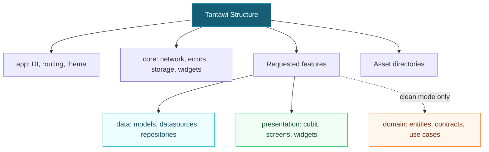

<div align="center">

# 🧱 Tantawi Structure

**Give your next Flutter app a familiar place to start.**

A reusable Codex skill that scaffolds a feature-first folder structure — ready for you to build on.

**Standard & Clean layouts · Feature-first organization · Python standard library only**

[Get started](#installation) · [Usage](#usage) · [Folder map](#folder-map) · [FAQ](#faq)

</div>

---

## What is it?

Starting a Flutter project often means recreating the same folders. Tantawi Structure handles that setup with one prompt:

```text
$tantawi-structure Set up only the folder structure for this Flutter app.
```

It separates application composition in `app/`, shared infrastructure in `core/`, and feature code in `features/`. Each requested feature gets `data/` and `presentation/`. Choose `clean` to add a pure Dart `domain/` layer.

**The output is a folder skeleton.** You choose the packages, write the code, and build the product.

## How it works



*This describes folder organization, not runtime dependencies.*

## Choose your layout

| Layout | Feature folders | When to choose it |
| --- | --- | --- |
| `standard` (default) | `data/` + `presentation/` | Start with a lightweight separation of data and UI. |
| `clean` | `data/` + `presentation/` + `domain/` | Explicit business rules, domain entities, and repository contracts need their own layer. |

Both layouts create folders only. Mode selection does not generate or validate architecture in your Dart code.

## What you get

| Capability | Behavior |
| --- | --- |
| Shared foundation | Separates app composition from shared networking, errors, storage, and widgets. |
| Layout selection | Defaults to `standard`; supports `--layout clean`. |
| Preview | `--dry-run` lists target folders without writing files. |
| Feature scaffolding | Adds only the feature names you request. |
| Asset organization | Creates image, SVG, animation, font, translation, and sound directories. |
| Existing content | Preserves existing files and adds missing directories. |
| Git-friendly folders | Adds `.gitkeep` files to empty target folders. |
| Standalone script | Runs with Python, even without Codex. |

## Requirements

- **Python 3.9 or later**, available as `python3` in the commands below.
- **Codex** to use the skill through a prompt, or a terminal to run the script directly.
- **Git** only if you choose to clone the repository.

The scaffold script uses the Python standard library. No `pip install` is needed. Flutter is needed to build your application, but not to create these folders.

## Installation

### 1. Download the skill

Download this repository as a ZIP and extract it, or clone it:

```bash
git clone https://github.com/YOUR_USERNAME/tantawi-structure.git
cd tantawi-structure
```

Replace `YOUR_USERNAME` with the repository owner's GitHub username. If you downloaded a ZIP, open a terminal inside its extracted repository folder.

### 2. Install it globally

Run the following from the repository root. It copies the skill into `$CODEX_HOME/skills/tantawi-structure`, or `~/.codex/skills/tantawi-structure` when `CODEX_HOME` is unset.

```bash
python3 - <<'PYTHON'
import os
from pathlib import Path
import shutil

source = Path.cwd()
files = ("SKILL.md", "agents/openai.yaml", "scripts/scaffold.py")
if not all((source / relative).is_file() for relative in files):
    raise SystemExit("Run this command from the tantawi-structure repository root.")

base = Path(os.environ.get("CODEX_HOME") or str(Path.home() / ".codex"))
target = base / "skills" / "tantawi-structure"
if target.exists():
    raise SystemExit(f"Already installed: {target}. Back up or move it before reinstalling.")

for relative in files:
    destination = target / relative
    destination.parent.mkdir(parents=True, exist_ok=True)
    shutil.copy2(source / relative, destination)

print(f"Installed: {target}")
PYTHON
```

The Bash heredoc above works in Bash and Zsh terminals, including macOS, Linux, and WSL. Windows users can use WSL or save the Python block to a `.py` file and run it with their Python interpreter.

### 3. Use it in your project

Open your Flutter project in Codex and invoke `$tantawi-structure`. The global installation is reusable across projects; you do not need to copy the skill into every app.

## Usage

### Create the base structure

```text
$tantawi-structure Create only the base folder structure for this Flutter app. Do not add any features yet.
```

This leaves `lib/features/` without feature subdirectories.

### Include selected features

```text
$tantawi-structure Scaffold the folder structure with login, profile, and settings features only.
```

Each requested feature gets:

```text
features/login/
├── data/
│   ├── models/
│   ├── datasources/
│   └── repositories/
└── presentation/
    ├── cubit/
    ├── screens/
    └── widgets/
```

### Request Clean Architecture folders

```text
$tantawi-structure Use the clean layout with login and profile features. Create folders only.
```

This adds `domain/entities/`, `domain/repositories/`, and `domain/usecases/` to each requested feature.

### Run the script directly

From the downloaded repository folder:

```bash
# Base folders only
python3 scripts/scaffold.py /absolute/path/to/my_app

# Include specific features
python3 scripts/scaffold.py /absolute/path/to/my_app \
  --feature login \
  --feature user_profile

# Preview the clean layout without writing files
python3 scripts/scaffold.py /absolute/path/to/my_app \
  --layout clean --feature profile --dry-run

# Create the clean layout
python3 scripts/scaffold.py /absolute/path/to/my_app \
  --layout clean --feature profile
```

Use lowercase snake_case feature names, such as `login`, `user_profile`, or `order_history`. Repeat `--feature` for each feature.

To create a runnable Flutter project first:

```bash
flutter create my_app
python3 /absolute/path/to/tantawi-structure/scripts/scaffold.py \
  "$(cd my_app && pwd -P)" \
  --feature login
```

The script does not run `flutter create` for you.

## Folder map

```text
my_app/
├── lib/
│   ├── app/
│   │   ├── di/
│   │   ├── routing/
│   │   └── theme/
│   ├── core/
│   │   ├── network/
│   │   ├── errors/
│   │   ├── storage/
│   │   └── widgets/
│   └── features/
│       └── <requested_feature>/
│           ├── data/
│           │   ├── models/
│           │   ├── datasources/
│           │   └── repositories/
│           ├── presentation/
│           │   ├── cubit/
│           │   ├── screens/
│           │   └── widgets/
│           └── domain/           # clean mode only
│               ├── entities/
│               ├── repositories/
│               └── usecases/
└── assets/
    ├── pngs/
    ├── svgs/
    ├── gifs/
    ├── fonts/
    ├── translations/
    └── sound/
```

`<requested_feature>` is illustrative. No feature is created unless requested. Empty target folders receive `.gitkeep` files, omitted here for clarity.

### Where future code belongs

| Location | Responsibility | Example file added later |
| --- | --- | --- |
| `app/di/` | Application dependency registration | `inject.dart` |
| `app/routing/` | Routes and route generation | `app_router.dart` |
| `app/theme/` | Theme and design tokens | `app_tokens.dart` |
| `core/network/` | Shared HTTP infrastructure | `dio_client.dart` |
| `core/errors/` | Shared error types | `failure.dart` |
| `core/storage/` | Shared storage adapters | `secure_storage.dart` |
| `core/widgets/` | Reusable UI across features | `app_button.dart` |
| `features/<name>/data/models/` | Serialization models | `profile_model.dart` |
| `features/<name>/data/datasources/` | Remote and local data access | `profile_remote_source.dart` |
| `features/<name>/data/repositories/` | Repository implementations | `profile_repository_impl.dart` |
| `features/<name>/presentation/cubit/` | Cubits and state | `profile_cubit.dart` |
| `features/<name>/presentation/screens/` | Screens | `profile_screen.dart` |
| `features/<name>/presentation/widgets/` | Feature-specific UI | `profile_header.dart` |
| `features/<name>/domain/entities/` | Pure Dart business entities (clean) | `profile.dart` |
| `features/<name>/domain/repositories/` | Repository interfaces (clean) | `profile_repository.dart` |
| `features/<name>/domain/usecases/` | Business rules and orchestration (clean) | `update_profile.dart` |

These are placement examples, not generated files. In standard mode, repository contracts can live beside implementations in `data/repositories/`. Cubits depend on repository contracts, not data sources or HTTP clients.

In clean mode, presentation and data depend on domain. Domain imports neither Flutter nor data/presentation. Use cases should contain meaningful rules or orchestration, rather than simply forwarding every repository call.

## Scope and behavior

- Creates folders and `.gitkeep` files only.
- Keeps existing Dart code, configuration, and assets intact.
- Does not install packages or change `pubspec.yaml`.
- Does not create screens, models, repositories, Cubits, or tests.
- Does not add Firebase, Sentry, authentication, API endpoints, or credentials.
- Does not register asset directories in Flutter; update `pubspec.yaml` when you add actual assets.
- Does not reorganize an existing application into this layout.

The default state folder is `presentation/cubit/`. No state management, HTTP, DI, or localization package is installed or required to scaffold folders.

## FAQ

### Can I run it more than once?

Yes. The script adds missing folders and preserves existing files. It does not remove folders or features from previous runs.

### Does it work in an empty folder?

Yes. It creates the directory skeleton, but the result needs Flutter project files before it can run as an app.

### Why do I get “Already installed”?

The installer refuses to overwrite an existing installation. Back up or move the installed `tantawi-structure` folder, then run the installer again. This preserves any local customizations until you decide how to handle them.

### Why is a symlink path rejected?

The script checks the destination and its parent directories for symlinks. Use the physical path to your project. In Bash or Zsh, run `pwd -P` inside the project to find it. On macOS, use `/private/tmp` rather than `/tmp` for temporary destinations.

### Why is a feature name rejected?

Use lowercase snake_case without spaces, hyphens, slashes, or leading/trailing underscores. For example, use `user_profile` instead of `User Profile`.

### Can I use another state management approach?

The default layout creates `presentation/cubit/` folders. Adapt the template for your preferred approach before scaffolding; the script does not have a state management selection flag.

### Can I upgrade a project created by the previous template?

This release changes the layout from `data/cubit/ui` to `data/presentation` and moves application setup into `app/`. It is not an automatic migration. The script rejects requested features containing top-level `ui/` or `cubit/` directories. Review and migrate existing code separately; it does not detect every possible conflicting layout.

### Can I switch between standard and clean?

Running clean mode after standard mode adds domain folders. It does not move repository contracts or change Dart imports. Running standard mode afterward does not delete domain folders. Review the code boundaries yourself when changing architecture.

## Repository contents

```text
tantawi-structure/
├── SKILL.md                # Instructions Codex follows
├── agents/
│   └── openai.yaml         # Skill display name and example prompt
├── scripts/
│   └── scaffold.py         # Standalone folder generator
├── tests/
│   └── test_scaffold.py     # Regression tests for the generator
├── .gitignore
└── README.md
```

## Run the checks

```bash
python3 -m unittest discover -s tests -v
```

## Publish your own copy

Create an empty GitHub repository named `tantawi-structure`. From this skill folder, replace `YOUR_USERNAME` and run:

```bash
git init -b main
git add SKILL.md agents/openai.yaml scripts/scaffold.py tests README.md .gitignore
git commit -m "Add Tantawi Structure skill"
git remote add origin https://github.com/YOUR_USERNAME/tantawi-structure.git
git push -u origin main
```

Publish this folder's contents only. Before sharing the repository, replace the `YOUR_USERNAME` placeholders in this README with your GitHub username so readers can copy the clone command directly.
