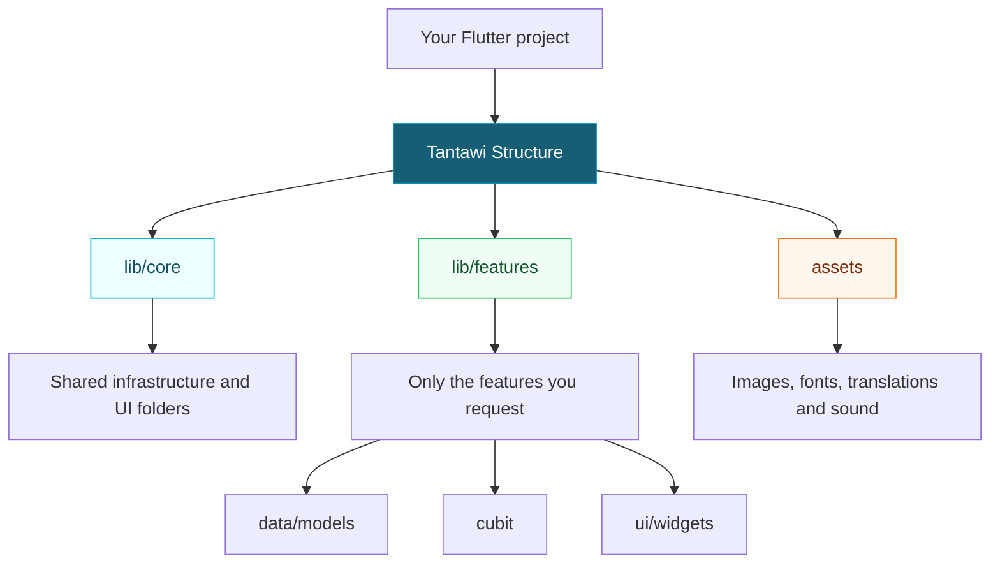

<div align="center">

# 🧱 Tantawi Structure

**Give your next Flutter app a familiar place to start.**

A reusable Codex skill that scaffolds a feature-first folder structure — ready for you to build on.

**Flutter folders · Feature-first organization · Python standard library only**

[Get started](#installation) · [Usage](#usage) · [Folder map](#folder-map) · [FAQ](#faq)

</div>

---

## What is it?

Starting a Flutter project often means recreating the same folders. Tantawi Structure handles that setup with one prompt:

```text
$tantawi-structure Set up only the folder structure for this Flutter app.
```

It creates shared folders under `core/`, a home for your features under `features/`, and asset directories. Request specific features to give each one its own `data/`, `cubit/`, and `ui/` folders.

**The output is a folder skeleton.** You choose the packages, write the code, and build the product.

## How it works



*This is a folder map, not a runtime dependency diagram.*

## What you get

| Capability | Behavior |
| --- | --- |
| Shared foundation | Creates folders for networking, dependency registration, routing, themes, services, and shared UI. |
| Feature scaffolding | Adds only the feature names you request. |
| Asset organization | Creates image, SVG, animation, font, translation, and sound directories. |
| Existing content | Preserves existing files and adds missing directories. |
| Git-friendly folders | Adds `.gitkeep` files to empty target folders. |
| Standalone script | Runs with Python, even without Codex. |

## Requirements

- **Python 3.9 or later**, available as `python3` in the commands below.
- **Codex** to use the skill through a prompt, or a terminal to run the script directly.
- **Git** only if you choose to clone the repository.

The scaffold script uses the Python standard library. No `pip install` is needed. Flutter is needed to build your application, but not to create these folders.

## Installation

### 1. Download the skill

Download this repository as a ZIP and extract it, or clone it:

```bash
git clone https://github.com/YOUR_USERNAME/tantawi-structure.git
cd tantawi-structure
```

Replace `YOUR_USERNAME` with the repository owner's GitHub username. If you downloaded a ZIP, open a terminal inside its extracted repository folder.

### 2. Install it globally

Run the following from the repository root. It copies the skill into `$CODEX_HOME/skills/tantawi-structure`, or `~/.codex/skills/tantawi-structure` when `CODEX_HOME` is unset.

```bash
python3 - <<'PYTHON'
import os
from pathlib import Path
import shutil

source = Path.cwd()
files = ("SKILL.md", "agents/openai.yaml", "scripts/scaffold.py")
if not all((source / relative).is_file() for relative in files):
    raise SystemExit("Run this command from the tantawi-structure repository root.")

base = Path(os.environ.get("CODEX_HOME") or str(Path.home() / ".codex"))
target = base / "skills" / "tantawi-structure"
if target.exists():
    raise SystemExit(f"Already installed: {target}. Back up or move it before reinstalling.")

for relative in files:
    destination = target / relative
    destination.parent.mkdir(parents=True, exist_ok=True)
    shutil.copy2(source / relative, destination)

print(f"Installed: {target}")
PYTHON
```

The Bash heredoc above works in Bash and Zsh terminals, including macOS, Linux, and WSL. Windows users can use WSL or save the Python block to a `.py` file and run it with their Python interpreter.

### 3. Use it in your project

Open your Flutter project in Codex and invoke `$tantawi-structure`. The global installation is reusable across projects; you do not need to copy the skill into every app.

## Usage

### Create the base structure

```text
$tantawi-structure Create only the base folder structure for this Flutter app. Do not add any features yet.
```

This leaves `lib/features/` without feature subdirectories.

### Include selected features

```text
$tantawi-structure Scaffold the folder structure with login, profile, and settings features only.
```

Each requested feature gets:

```text
features/login/
├── data/
│   └── models/
├── cubit/
└── ui/
    └── widgets/
```

### Run the script directly

From the downloaded repository folder:

```bash
# Base folders only
python3 scripts/scaffold.py /absolute/path/to/my_app

# Include specific features
python3 scripts/scaffold.py /absolute/path/to/my_app \
  --feature login \
  --feature user_profile
```

Use lowercase snake_case feature names, such as `login`, `user_profile`, or `order_history`. Repeat `--feature` for each feature.

To create a runnable Flutter project first:

```bash
flutter create my_app
python3 /absolute/path/to/tantawi-structure/scripts/scaffold.py \
  "$(cd my_app && pwd -P)" \
  --feature login
```

The script does not run `flutter create` for you.

## Folder map

```text
my_app/
├── lib/
│   ├── core/
│   │   ├── constant/
│   │   ├── di/
│   │   ├── enums/
│   │   ├── extension/
│   │   ├── models/
│   │   ├── network/
│   │   ├── routing/
│   │   ├── services/
│   │   ├── shared/
│   │   │   ├── bottom_sheets/
│   │   │   ├── screens/
│   │   │   ├── utils/
│   │   │   └── widgets/
│   │   ├── theme/
│   │   └── utils/
│   └── features/
│       └── <requested_feature>/
│           ├── data/
│           │   └── models/
│           ├── cubit/
│           └── ui/
│               └── widgets/
└── assets/
    ├── pngs/
    ├── svgs/
    ├── gifs/
    ├── fonts/
    ├── translations/
    └── sound/
```

`<requested_feature>` is an illustration, not a literal folder. It appears only when you supply a feature name. Empty target folders contain `.gitkeep` files, omitted from the diagram for clarity.

### Where future code belongs

| Location | Intended responsibility | Example file added later |
| --- | --- | --- |
| `core/di/` | Dependency registration | `inject.dart` |
| `core/network/` | Shared HTTP client and API configuration | `dio_client.dart` |
| `core/routing/` | Routes and route generation | `app_router.dart` |
| `core/theme/` | Theme definitions and design tokens | `app_tokens.dart` |
| `core/services/` | Shared infrastructure services | `secure_storage_service.dart` |
| `core/shared/widgets/` | Reusable UI across features | `app_button.dart` |
| `features/<name>/data/` | Feature repositories | `profile_repository.dart` |
| `features/<name>/data/models/` | API and serialization models | `profile_model.dart` |
| `features/<name>/cubit/` | Cubits and their state files | `profile_cubit.dart` |
| `features/<name>/ui/` | Feature screens | `profile_screen.dart` |
| `features/<name>/ui/widgets/` | Widgets specific to the feature | `profile_header.dart` |

These filenames describe future placement; the scaffold does not generate them. Keep feature-specific helpers inside their feature and reserve `core/` for shared concerns.

## Scope and behavior

- Creates folders and `.gitkeep` files only.
- Keeps existing Dart code, configuration, and assets intact.
- Does not install packages or change `pubspec.yaml`.
- Does not create screens, models, repositories, Cubits, or tests.
- Does not add Firebase, Sentry, authentication, API endpoints, or credentials.
- Does not register asset directories in Flutter; update `pubspec.yaml` when you add actual assets.
- Does not reorganize an existing application into this layout.

The layout is intended for a lightweight Cubit-based workflow. GetIt, Dio, and EasyLocalization are compatible choices, but none is installed or required by the scaffold. This template uses `data/cubit/ui`; it does not generate a separate domain layer.

## FAQ

### Can I run it more than once?

Yes. The script adds missing folders and preserves existing files. It does not remove folders or features from previous runs.

### Does it work in an empty folder?

Yes. It creates the directory skeleton, but the result needs Flutter project files before it can run as an app.

### Why do I get “Already installed”?

The installer refuses to overwrite an existing installation. Back up or move the installed `tantawi-structure` folder, then run the installer again. This preserves any local customizations until you decide how to handle them.

### Why is a symlink path rejected?

The script checks the destination and its parent directories for symlinks. Use the physical path to your project. In Bash or Zsh, run `pwd -P` inside the project to find it. On macOS, use `/private/tmp` rather than `/tmp` for temporary destinations.

### Why is a feature name rejected?

Use lowercase snake_case without spaces, hyphens, slashes, or leading/trailing underscores. For example, use `user_profile` instead of `User Profile`.

### Can I use another state management approach?

The default layout creates `cubit/` folders. Adapt the template for your preferred approach before scaffolding; the script does not have a state management selection flag.

## Repository contents

```text
tantawi-structure/
├── SKILL.md                # Instructions Codex follows
├── agents/
│   └── openai.yaml         # Skill display name and example prompt
├── scripts/
│   └── scaffold.py         # Standalone folder generator
├── .gitignore
└── README.md
```

